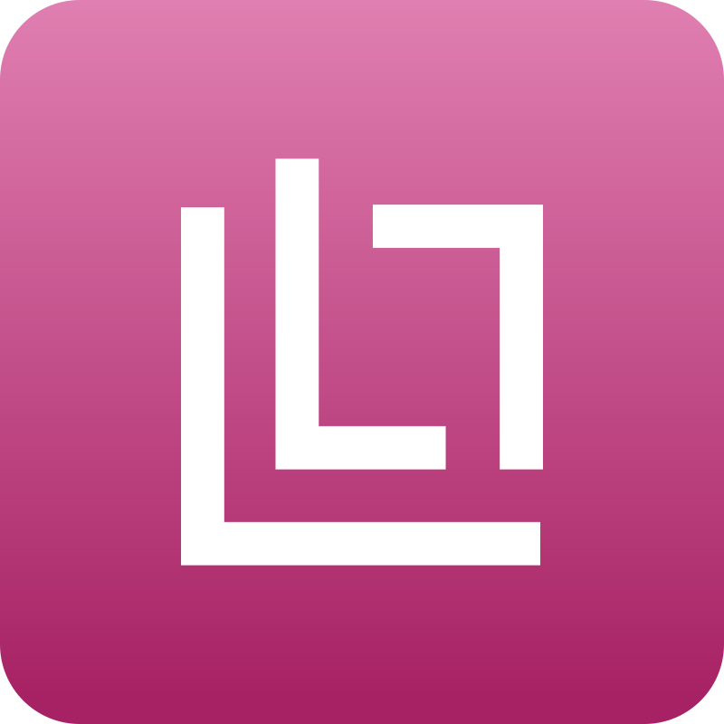

:hide-toc:

.. Start page. The section title names the page for the browser tab and search;
   the hero shows its own, larger title.

.. rst-class:: ls-landing

LightlySSL
==========

.. raw:: html

   

     
     
     
Learn from images and video without labels

     
Pretrain vision backbones with 28 self-supervised methods, or train a latent world model that plans from raw frames. All in plain PyTorch.

     

       <a class="ls-btn ls-btn-primary" href="getting_started/install.html">Get started</a>
       <a class="ls-btn ls-btn-ghost" href="examples/models.html">Browse methods</a>
       <a class="ls-btn ls-btn-ghost" href="https://github.com/lightly-ai/lightly">GitHub</a>
     

     

       

   <pre>$ pip install lightly
   # the example scripts live in the repository
   $ git clone https://github.com/lightly-ai/lightly.git
   # pretrain a ResNet-18 with SimCLR on CIFAR-10
   $ python lightly/examples/pytorch/simclr.py
   # or with Lightning on several GPUs
   $ python lightly/examples/pytorch_lightning_distributed/simclr.py</pre>
     

   

.. rst-class:: ls-section-title

What's new
----------

.. container:: ls-feature

   .. container:: ls-feature-media

      .. image:: ../assets/lewm_planning.gif
         :alt: Four agents planned by LeWM pass through a door to reach their goals

   .. container:: ls-feature-body

      .. rst-class:: ls-pill

      New in 1.6

      .. rst-class:: ls-feature-title

      Latent world models with LeWM

      A world model learns how a scene responds to actions. LeWM learns it from raw
      frames and actions, then plans by imagining the outcome of each move in its own
      embedding space.

      .. rst-class:: ls-feature-note

      Each agent (orange) gets only a picture of its goal (white box). It learned from
      random play: no rewards, no labels, no map of the room.

      .. container:: ls-feature-actions

         .. button-ref:: lightly-lewm-tutorial-9
            :ref-type: ref
            :color: primary

            Train a world model

         .. button-ref:: lewm
            :ref-type: ref
            :color: primary
            :outline:

            How LeWM works

.. grid:: 1 1 3 3
   :gutter: 3
   :class-container: ls-news

   .. grid-item-card::
      :link: capi
      :link-type: ref

      .. rst-class:: ls-pill

      New in 1.6

      .. rst-class:: ls-news-title

      CAPI

      Masked image modeling that predicts the cluster assignments of masked
      patches instead of their pixels.

   .. grid-item-card::
      :link: pixio
      :link-type: ref

      .. rst-class:: ls-pill

      New in 1.5.26

      .. rst-class:: ls-news-title

      Pixio, FroSSL and DetConS

      Three more methods: a masked autoencoder variant, Frobenius norm
      minimization, and object-level contrastive learning.

   .. grid-item-card::
      :link: lejepa
      :link-type: ref

      .. rst-class:: ls-pill

      New in 1.5.25

      .. rst-class:: ls-news-title

      LeJEPA

      Invariance plus SIGReg: no negative samples, momentum encoders or
      stop-gradients.

.. rst-class:: ls-section-title

Start here
----------

.. grid:: 1 2 2 4
   :gutter: 3

   .. grid-item-card:: :octicon:`rocket;1.2em` Get started
      :link: rst-installing
      :link-type: ref

      Install LightlySSL and learn the main concepts.

   .. grid-item-card:: :octicon:`mortar-board;1.2em` Tutorials
      :link: input-structure-label
      :link-type: ref

      Step-by-step notebooks, from data loading to fine-tuning.

   .. grid-item-card:: :octicon:`beaker;1.2em` Methods
      :link: models
      :link-type: ref

      Reference implementations in PyTorch and Lightning.

   .. grid-item-card:: :octicon:`code;1.2em` Python API
      :link: /lightly
      :link-type: doc

      Losses, heads, transforms and data utilities.

.. rst-class:: ls-section-title

All methods
-----------

.. Each family container carries ls-family-<key>; _static/method-filter.js hides
   the other families and fills in the count on each button.

.. raw:: html

   

     <button type="button" class="ls-filter-btn is-active" data-family="all">All</button>
     <button type="button" class="ls-filter-btn" data-family="contrastive">Contrastive</button>
     <button type="button" class="ls-filter-btn" data-family="distillation">Self-distillation</button>
     <button type="button" class="ls-filter-btn" data-family="masked">Masked image modeling</button>
     <button type="button" class="ls-filter-btn" data-family="redundancy">Redundancy reduction</button>
     <button type="button" class="ls-filter-btn" data-family="clustering">Clustering and dense</button>
     <button type="button" class="ls-filter-btn" data-family="world">World models</button>
   

.. container:: ls-chips ls-filter-target

   .. container:: ls-fam-item ls-family-contrastive

      :ref:`SimCLR <simclr>` :ref:`MoCo <moco>` :ref:`NNCLR <nnclr>`
      :ref:`DCL & DCLW <dcl>` :ref:`TiCo <tico>`

   .. container:: ls-fam-item ls-family-distillation

      :ref:`BYOL <byol>` :ref:`SimSiam <simsiam>` :ref:`FastSiam <fastsiam>`
      :ref:`DINO <dino>` :ref:`DINOv2 <dinov2>` :ref:`MSN <msn>` :ref:`PMSN <pmsn>`

   .. container:: ls-fam-item ls-family-masked

      :ref:`MAE <mae>` :ref:`SimMIM <simmim>` :ref:`iBOT <ibot>`
      :ref:`AIM <aim>` :ref:`CAPI <capi>` :ref:`Pixio <pixio>`

   .. container:: ls-fam-item ls-family-redundancy

      :ref:`Barlow Twins <barlowtwins>` :ref:`VICReg <vicreg>`
      :ref:`VICRegL <vicregl>` :ref:`MMCR <mmcr>` :ref:`FroSSL <frossl>`
      :ref:`LeJEPA <lejepa>`

   .. container:: ls-fam-item ls-family-clustering

      :ref:`SwaV <swav>` :ref:`SMoG <smog>` :ref:`DenseCL <densecl>`
      :ref:`DetConS <detcon>`

   .. container:: ls-fam-item ls-family-world

      :ref:`LeWM <lewm>`

.. rst-class:: ls-section-title

More from Lightly
-----------------

.. grid:: 1 2 2 4
   :gutter: 3

   .. grid-item-card:: |train-mark| Lightly\ **Train**
      :link: https://docs.lightly.ai/train/stable/index.html

      Pretrain and fine-tune vision foundation models with a few lines of code.

   .. grid-item-card:: |studio-mark| Lightly\ **Studio**
      :link: https://docs.lightly.ai/studio/

      Label, curate and inspect your datasets.

   .. grid-item-card:: :octicon:`comment-discussion;1.2em` Discord
      :link: https://discord.gg/xvNJW94

      Join the community and our weekly paper sessions.

   .. grid-item-card:: :octicon:`mark-github;1.2em` GitHub
      :link: https://github.com/lightly-ai/lightly

      Star the repo, file issues and contribute.

.. toctree::
   :maxdepth: 1
   :hidden:
   :caption: Getting Started

   getting_started/main_concepts.rst
   getting_started/install.rst
   getting_started/command_line_tool.rst
   getting_started/lightly_at_a_glance.rst

.. toctree::
   :maxdepth: 1
   :hidden:
   :caption: World Models

   examples/lewm.rst
   tutorials/package/tutorial_lewm.rst

.. toctree::
   :maxdepth: 1
   :hidden:
   :caption: Advanced

   getting_started/advanced.rst
   getting_started/distributed_training.rst
   getting_started/benchmarks.rst

.. toctree::
   :maxdepth: 1
   :hidden:
   :caption: Tutorials

   tutorials/structure_your_input.rst
   tutorials/package/tutorial_moco_memory_bank.rst
   tutorials/package/tutorial_simclr_clothing.rst
   tutorials/package/tutorial_simsiam_esa.rst
   tutorials/package/tutorial_custom_augmentations.rst
   tutorials/package/tutorial_pretrain_detectron2.rst
   tutorials/package/tutorial_checkpoint_finetuning.rst
   tutorials/package/tutorial_timm_backbone.rst

.. toctree::
   :maxdepth: 1
   :hidden:
   :caption: Examples

   examples/models.rst

.. toctree::
   :maxdepth: 1
   :hidden:
   :caption: Python API

   lightly
   lightly.cli
   lightly.core
   lightly.data
   lightly.loss
   lightly.models
   lightly.models.utils
   lightly.transforms
   lightly.utils

.. toctree::
   :maxdepth: 1
   :hidden:
   :caption: On-Premise

   docker_archive/overview.rst
